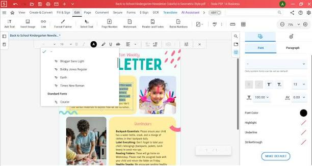
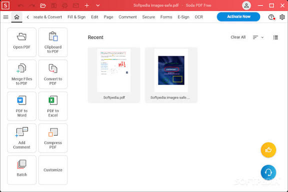

# Soda PDF Handles the Work Between Drafts

A document can arrive as a scan, a collection of attachments, or a form that still needs a response.
Soda PDF combines editing, conversion, page organization, OCR, and signing tools across desktop and online workflows.
Begin by identifying the document's structure and the result the next reader needs.

## Identify the Document Before Choosing the Tool

A page that looks like text may contain only a photograph of text.
A visible answer box may be artwork rather than an interactive field.
These distinctions explain why the same editing action works in one PDF and fails in another.

| What you observe | What to establish | Appropriate next step |
| --- | --- | --- |
| Text selects as individual words | Whether editing is permitted | Revise the existing text |
| The whole page behaves as one image | Whether it needs recognition | Run OCR before working with its text |
| A box accepts a cursor and saves an answer | Whether it is an interactive field | Fill the field and reopen the saved copy |
| A printed box has no interactive behavior | Whether a form field must be added | Prepare a fillable form |
| Several files belong to one submission | The required document order | Merge and inspect the resulting packet |

The [editing guide](https://www.sodapdf.com/document-doctor/problems/editing-text/) explains common content and permission differences.
Keep the received document as a reference while preparing the working copy.
Choose a representative page before applying the same operation throughout a long file.

[](https://soda-pdf-pro.github.io/Soda-PDF/)

## Turn Scanned Pages into Usable Text

OCR recognizes characters in scanned documents and image-based pages.
In Soda PDF, recognition can make scanned content available for text work.
Recognition quality still depends on the source image and the language being processed.

Start with a page containing headings, ordinary paragraphs, and any small print.
Compare names, dates, reference numbers, and decimal separators with the image.
A successful search for one word does not establish that every character was recognized correctly.



For a separate command-line preparation step, OCRmyPDF can correct orientation and skew while adding text.
This example assumes an image-only English scan and an available English Tesseract language pack:

```powershell
ocrmypdf --language eng --rotate-pages --deskew --output-type pdf "scan-original.pdf" "scan-searchable.pdf"
```

Use a new output filename so the received scan remains available for comparison.
Open the result in Soda PDF and check both the visible page and the recognized text.
The command adds an OCR layer; it does not create interactive form fields.

Language data and processing dependencies are also relevant when comparing automated PDF systems.
The supplied Stirling-PDF [Dockerfile](docker/base/Dockerfile) describes a base image with document-processing tools.
Its [Dockerfile.fat](docker/embedded/Dockerfile.fat) includes an expanded image recipe with extra fonts.
[Dockerfile.ultra-lite](docker/embedded/Dockerfile.ultra-lite) describes a reduced embedded image.

The processing engine has its own [Dockerfile](docker/engine/Dockerfile).
[Dockerfile.dev](docker/engine/Dockerfile.dev) describes the development variant.
These files help explain why different processing environments can have different capabilities.

## Revise Content and Collect Answers Deliberately

Use the Soda PDF editor for the kind of change the document actually needs.
A correction to an existing paragraph is different from adding an annotation.
For a form, an answer should be stored in a usable field when that is what the recipient expects.

### Text and page objects

Keep the original wording available while changing a paragraph or replacing an image.
Review line breaks and nearby content after a text change.
A small correction can alter the visual balance of a tightly arranged page.

Convert to an Office format when the next task requires that application's editing model.
After a PDF-to-Word or PDF-to-Excel conversion, compare the result with the PDF.
Check columns, reading order, tables, and page boundaries rather than assuming a perfect reconstruction.

### Interactive forms

Soda PDF supports creating fillable forms and completing existing ones.
Try a sample response, save the document, close it, and reopen the saved copy.
That checks whether the answer persists beyond the current editing session.

- Check whether each field has a clear purpose.
- Distinguish a typed annotation from a stored form value.
- Confirm that the intended recipient can complete the form.
- Keep an uncompleted working version when the form will be reused.



The supplied web-interface references illustrate another distinction: interface delivery and document processing.
Stirling-PDF's frontend [Dockerfile](docker/frontend/Dockerfile) builds and packages the browser interface.
[nginx.conf](docker/frontend/nginx.conf) describes web serving and request routing.
[entrypoint.sh](docker/frontend/entrypoint.sh) applies the configured backend address when that container starts.

A browser interface being available does not establish that every document operation is available.
Check the actual tool and account capabilities in the Soda PDF workspace you are using.

## Assemble the Reading Order Before Final Approval

A combined PDF should follow the order in which the recipient needs to read it.
Place the cover material, main document, and supporting pages intentionally.
Check page orientation and remove unintended duplicates before sending the result.

Soda PDF provides merging, splitting, page rotation, and page reordering.
Use page thumbnails to inspect transitions between source documents.
Mixed portrait and landscape pages deserve a separate review after assembly.

Python with pypdf offers a companion example for assembling a deliberately limited review packet.
This creates a cover followed by the first two pages of an attachment:

```python
from pypdf import PdfWriter
packet = PdfWriter()
packet.append("cover.pdf")
packet.append("attachment.pdf", pages=(0, 2))
with open("review-packet.pdf", "xb") as output:
    packet.write(output)
packet.close()
```

The page range uses zero-based indexing and excludes its upper bound.
The attachment therefore needs at least two pages.
The exclusive output mode avoids replacing an existing packet with that filename.

For this example, use ordinary document PDFs without required signatures or interactive form behavior.
Documents with those features need a workflow that explicitly preserves them.
Open the assembled copy in Soda PDF and verify the cover-to-attachment transition.

### Finish sensitive changes before signing

A white rectangle can cover text visually without removing the underlying information.
Use the appropriate redaction operation when permanent removal is required.
A password restriction and an applied redaction serve different purposes.

Complete content changes and page assembly before the final signing step.
Keep the resulting signed copy distinct from documents that remain under revision.
Confirm that the selected signing tool and service are available for the account in use.

In deployment examples, a security-related filename is not proof that authentication is enabled.
Inspect the settings in [docker-compose-latest-security.yml](docker/embedded/compose/docker-compose-latest-security.yml).
Compare [docker-compose-latest-fat-security.yml](docker/embedded/compose/docker-compose-latest-fat-security.yml) with [docker-compose-latest-fat-endpoints-disabled.yml](docker/embedded/compose/docker-compose-latest-fat-endpoints-disabled.yml).
The supplied security-named examples explicitly set SECURITY_ENABLELOGIN to false.

## Choose the Workspace That Fits the Job

Soda PDF desktop and Soda PDF online provide different ways to access document tools.
Check where the required operation is available before moving a document between them.
A Soda PDF Pro subscription or product label should be checked against its current feature allocation.

The product site identifies AI assistance and translation as Soda PDF Online features.
Treat a generated summary as an aid to review and compare important details with the document.
For ordinary editing, use the workspace that supports the required operation and file handling.

The following Stirling-PDF references illustrate deployment layouts when evaluating a separate processing environment:

- [README.md](docker/README.md) describes the supplied Docker organization.
- [Dockerfile](docker/embedded/Dockerfile) packages an embedded frontend with the application.
- [Dockerfile](docker/backend/Dockerfile) describes a backend-only application image.
- [docker-compose.yml](docker/compose/docker-compose.yml) defines the standard composition.
- [docker-compose.fat.yml](docker/compose/docker-compose.fat.yml) defines the expanded composition.
- [docker-compose.ultra-lite.yml](docker/compose/docker-compose.ultra-lite.yml) defines the reduced composition.

The unified examples describe additional arrangements:

- [docker-compose-unified-frontend.yml](docker/compose/docker-compose-unified-frontend.yml) describes a frontend arrangement connected to a backend.
- [docker-compose-unified-backend.yml](docker/compose/docker-compose-unified-backend.yml) describes a backend-only arrangement.
- [docker-compose-unified-both.yml](docker/compose/docker-compose-unified-both.yml) describes a combined arrangement.
- [docker-compose-latest-ultra-lite.yml](docker/embedded/compose/docker-compose-latest-ultra-lite.yml) supplies another reduced-image example.

Those examples concern the deployment model of the named project.
They do not establish an equivalent hosting mode or API for Soda PDF.

## Keep the Delivery Copy and the Processing Record

Before delivery, reopen the saved PDF rather than checking only the document still visible in the editor.
Review the first and last pages, the transitions between attachments, and a representative form answer.
After compression or conversion, inspect fine text and image detail at a useful viewing scale.

Keep the received files, editable working copy, and delivery copy distinguishable.
For repeated document work, record which recognition, conversion, and assembly steps were applied.
This makes a later correction easier to reproduce.

The supplied technical material also records how a companion processing project is assembled.
[build.gradle](build.gradle) declares its main build plugins and dependencies.
[settings.gradle](settings.gradle) defines the Gradle project configuration.
[gradle.properties](gradle.properties) records build execution settings.
[gradle-wrapper.properties](gradle/wrapper/gradle-wrapper.properties) identifies the Gradle distribution.

[Taskfile.yml](Taskfile.yml) organizes task groups.
[spotless.gradle](gradle/spotless.gradle) describes source-formatting rules.
These are build references, not document-editing commands.

Dependency reporting is documented in [README.md](buildSrc/README.md).
Its supporting [build.gradle](buildSrc/build.gradle) configures the custom build logic.
[ModuleLicenseOverrideFilter.groovy](buildSrc/src/main/groovy/stirling/software/gradle/ModuleLicenseOverrideFilter.groovy) handles dependency-license overrides.
[PreferredLicenseFilter.groovy](buildSrc/src/main/groovy/stirling/software/gradle/PreferredLicenseFilter.groovy) selects reported license information.
[ModuleLicenseOverrideFilterTest.groovy](buildSrc/src/test/groovy/stirling/software/gradle/ModuleLicenseOverrideFilterTest.groovy) and [PreferredLicenseFilterTest.groovy](buildSrc/src/test/groovy/stirling/software/gradle/PreferredLicenseFilterTest.groovy) test that reporting logic.

## Related Search Terms

Soda PDF Pro, Soda PDF, soda pdf desktop, soda pdf online, soda pdf editor, pdf, pdf-editor, pdf-converter, pdf-manipulation, pdf-merger, pdf-ocr, pdf-tools, pdf-viewer, ocr, document-management
